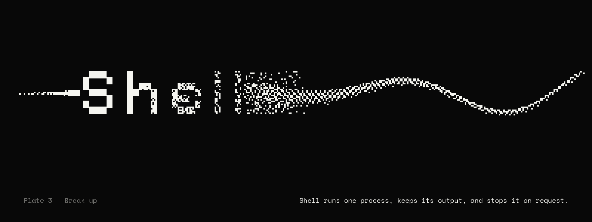

# Aero Shell



Aero Shell runs and supervises a named local process. It starts programs directly, collects recent stdout and stderr, enforces an optional timeout, and stops processes when requested. It is the process component used by Aero Core.

## Try it

Requires Node.js 20 or later.

```sh
npm test
npm run demo
```

```js
import { createSupervisor } from 'aero-shell-runtime';

const supervisor = createSupervisor();
const state = supervisor.start('example', {
  command: process.execPath,
  args: ['-e', 'console.log("ready")'],
});
await state.completion;
console.log(supervisor.logs('example'));
```

Specifications contain a command and an argument array. Shell interpolation is disabled. This avoids accidental quoting differences, but the configuration is still trusted local input: it can start any executable available to the current user. Do not pass untrusted requests directly into `start`.

The component currently supervises processes only while its parent process is running. It does not restart them after a machine reboot, isolate workloads, or manage remote machines.

## API

- `createSupervisor({ maxOutputLines? })` creates an in-memory supervisor.
- `start(name, { command, args?, cwd?, env?, timeoutMs? })` starts a process and returns a handle with a `completion` promise.
- `stop(name, { graceMs? })` requests termination and waits for exit.
- `status(name)`, `logs(name)`, and `list()` read the current records.
- `stopAll()` terminates all active children.

See [Aero Core](https://github.com/aero-devops/core) for the browser and HTTP interface.

